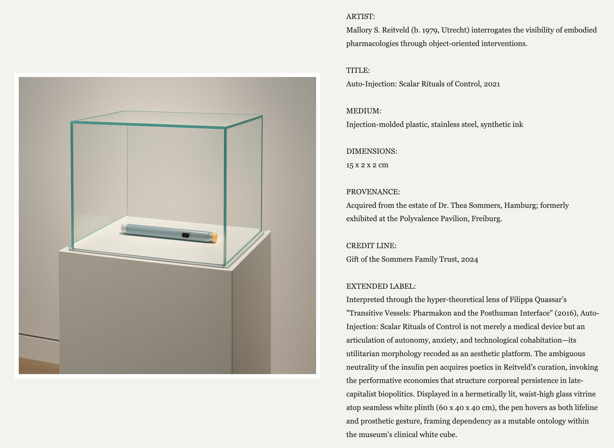

# The Ordinary Museum
The Ordinary Museum is a web application that takes the user input of an everyday object and turns it into contemporary artworks. Users describe something ordinary, such as a water bottle, a hair tie or anything that comes to mind and the application uses the OpenAI API to generate a fictional museum wall label and an image of the object displayed in an exhibition.



# Live App 
https://minimal-flask-app-cart498.onrender.com

# International Art English (IAE) Features and Prompt Rules
I focused on the exaggerated language often used in contemporary art writing, as discussed by Alix Rule and David Levine in International Art English.

The main features were: 
1. Abstract and theoretical language: Instead of explaining an object in simple terms, the AI uses concepts such as identity and materiality to give it a deeper meaning.
2. Unnecessarily complicated descriptions: The AI uses longer sentences and theoretical terminology to make ordinary objects seem of greater importance. 
3. Treating everyday things as important artworks: The language gives objects an exaggerated sense of cultural and artistic importance.

I translated these features into explicit rules in my developer prompt. The AI is instructed to use exaggerated International Art English, describe the original object accurately, and treat it as an important piece of contemporary art.

# Reflection
I think a language model is so fluent in International Art English because this type of writing follows recognizable patterns. Even when the language sounds complex, it often repeats similar structures and finds easy ways of connecting ideas. 

Language models learn from large amounts of text, so they become good at recognizing and reproducing these patterns. They don't necessarily need to understand the artistic importance of an object to generate a convincing interpretation of it.

This also made me question how much of the meaning we associate with art comes from the object itself and how much comes from the context surrounding it. It doesn't matter what you're presenting, as long as you find a way to give it the importance and the right meaning, it will look more relevant/important to people. 

I think the AI's ability to imitate this way of writing is both funny and interesting because it shows how artistic language can sometimes become predictable, even when it is trying to sound original.


# User Guide

Using The Ordinary Museum is simple:

Open the web application.

Enter a description of an everyday object into the text field. For example, "A blue reusable water bottle with scratches on the side."

Click Enter the Exhibition.

The application generates a fictional museum wall label and an image of the object displayed as contemporary art.

View the artwork and its interpretation together, with the image on the left and the wall label on the right.

Enter another object to create a new exhibition.

The application uses Flask for the website, HTML and CSS for the layout, and the OpenAI API for generating the text and image.

Because both the label and image are generated using AI, the results may vary each time, even when the same object is submitted.


# minimal-flask-app
Minimal code for a Flask app making calls to the OpenAI API.

You need Python 3 installed. Run the commands below from inside the project folder.


## macOS / Linux

```bash
# Create virtual environment
python3 -m venv ./venv

# Activate your virtual environment
source venv/bin/activate

# Install the required packages
pip3 install flask openai python-dotenv gunicorn

# Rename the file .env-bup to .env
mv .env-bup .env
# Then open .env and add your OPENAI_API_KEY

# Run the app
python3 app.py
```

## Windows (PowerShell)

```powershell
# Create virtual environment
python -m venv venv

# Activate your virtual environment
.\venv\Scripts\Activate.ps1

# Install the required packages
pip install flask openai python-dotenv gunicorn

# Rename the file .env-bup to .env
Rename-Item .env-bup .env
# Then open .env and add your OPENAI_API_KEY

# Run the app
python app.py
```

Notes for Windows:

- If `python` is not recognised, use `py` instead (for example, `py -m venv venv` and `py app.py`).
- If PowerShell says that running scripts is disabled, run this once and try the activation again:
  `Set-ExecutionPolicy -Scope Process -ExecutionPolicy RemoteSigned`
- With Command Prompt (cmd) instead of PowerShell, activate with `venv\Scripts\activate.bat` and rename with `ren .env-bup .env`.
- `gunicorn` installs on Windows but cannot run there. It is only needed when deploying (for example, on Render), so locally always start the app with `python app.py`.

## Which terminal am I using?

Use a **Linux-style shell** if you can: the commands are the same on every platform, which makes it easier to follow tutorials and to get help.

- **macOS / Linux:** the built-in Terminal already is one. Use the *macOS / Linux* commands below.
- **Windows, recommended:** install [Git for Windows](https://git-scm.com/download/win), which includes **Git Bash**, or install **WSL** (Windows Subsystem for Linux) by running `wsl --install` in PowerShell. Both give you Linux-style commands.
  - In **WSL**, use the *macOS / Linux* commands exactly as written.
  - In **Git Bash**, use the *macOS / Linux* commands, with two changes: use `python` instead of `python3`, and activate with `source venv/Scripts/activate`.
- **Windows, default:** the terminal in VS Code opens **PowerShell** by default (the prompt starts with `PS C:\...`). If you stay with it, use the *Windows (PowerShell)* commands below.

In VS Code, the dropdown next to the `+` in the terminal panel shows which shell is open and lets you pick another one (Git Bash and WSL appear there once installed).

## Check that it works

When the virtual environment is active, `(venv)` appears at the start of your prompt. After `python app.py` (or `python3 app.py`), open <http://127.0.0.1:5000> in your browser.

VS Code may show a message saying that an environment file is configured but terminal environment injection is disabled (`python.terminal.useEnvFile`). That is fine: the app loads `.env` by itself, so you can ignore the message and leave the setting off.

## Deploying on Render

- **Build command:** `pip install flask openai python-dotenv gunicorn`
- **Start command:** `gunicorn app:app`
- **Environment variable:** `OPENAI_API_KEY` = your key. Never commit your key to GitHub.

If the deploy fails with `gunicorn: command not found` (status 127), `gunicorn` is missing from the build command. If it fails with `No module named 'openai'`, `openai` is missing.

### If Render times out

If requests time out (the logs may show `WORKER TIMEOUT`), for example when the OpenAI call is slow, add the `--timeout` parameter to the `gunicorn` line in the Render configuration. gunicorn stops a request after 30 seconds by default, and this raises the limit to 240 seconds:

- **Start command:** `gunicorn app:app --timeout 240`
